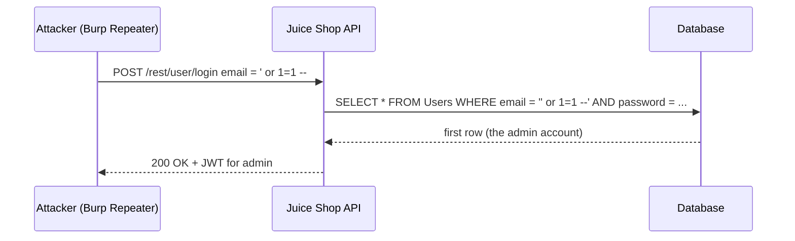

<div align="center">

# OWASP Juice Shop: Security Assessment

**A two-part web application penetration test with 12 findings, each with a working proof of concept, its root cause, and a fix.**


[](LICENSE)

</div>

## At a glance

| | |
|---|---|
| **Target** | [OWASP Juice Shop](https://owasp.org/www-project-juice-shop/), the OWASP Foundation's deliberately insecure training app, run locally in Docker |
| **Scope** | 6 client-side findings and 6 server-side findings |
| **Tooling** | Burp Suite (proxy, repeater), browser devtools, hand-crafted HTTP requests and JWTs |
| **Evidence** | Screenshots in each part's `images/` folder; full submitted reports as `report-original.pdf` |
| **Context** | Coursework for a Software and Mobile Device Security module (GIU) |

> **Scope note:** Juice Shop is purpose-built for security training and tool benchmarking. All testing was done against a local Docker instance, never a production system.


*SQL injection on the login form: `' or 1=1 --` in the email field returns a valid session for the first user in the database, the admin account.*

## Contents

[All findings](#all-findings) · [Walkthrough: SQL injection login bypass](#walkthrough-sql-injection-login-bypass) · [Methodology](#methodology) · [Repository layout](#repository-layout) · [What this shows](#what-this-shows)

## All findings

The OWASP Top 10 (2021) category is my own **indicative** mapping, added for skimming; the detailed write-ups in each part are the authoritative description.

| # | Finding | Part | OWASP Top 10 (2021, indicative) |
|---|---|---|---|
| 1 | DOM-based XSS in the search bar | [client](client-side/) | A03 Injection |
| 2 | Reflected XSS via the search query parameter | [client](client-side/) | A03 Injection |
| 3 | Stored XSS in the complaint/feedback form | [client](client-side/) | A03 Injection |
| 4 | CSRF on password and username change | [client](client-side/) | A01 Broken Access Control |
| 5 | Clickjacking, combined with XSS | [client](client-side/) | A05 Security Misconfiguration |
| 6 | CORS misconfiguration exposing data | [client](client-side/) | A05 Security Misconfiguration |
| 7 | SQL injection: authentication bypass | [server](server-side/) | A03 Injection |
| 8 | SQL injection: search endpoint (filter bypass) | [server](server-side/) | A03 Injection |
| 9 | IDOR on the shopping basket | [server](server-side/) | A01 Broken Access Control |
| 10 | Privilege escalation via the registration role field | [server](server-side/) | A01 Broken Access Control |
| 11 | Missing rate limiting on login | [server](server-side/) | A07 Identification and Authentication Failures |
| 12 | JWT `alg: none` forgery | [server](server-side/) | A07 Identification and Authentication Failures |

## Walkthrough: SQL injection login bypass



- **Root cause:** the login query is built by string concatenation, so input becomes SQL.
- **Fix:** parameterized queries (prepared statements) and an ORM that binds values; never concatenate user input into SQL.
- **Defense in depth:** least-privilege database account, generic login errors, rate limiting.

The sequence above illustrates the mechanism; the real request and response are in the screenshot and in [`server-side/`](server-side/).

## Methodology

For each vulnerability: build a working proof of concept and verify it (browser devtools and the Burp Suite proxy and repeater), identify the root cause, and document concrete mitigations, mirroring the structure of a professional web application penetration test report.

## Repository layout

```text
.
├── client-side/
│   ├── README.md              # 6 findings, condensed
│   ├── images/                # evidence screenshots
│   └── report-original.pdf    # full submitted report
├── server-side/
│   ├── README.md              # 6 findings, condensed
│   ├── images/
│   └── report-original.pdf
└── LICENSE
```

## What this shows

OWASP Top 10 classes in practice, a Burp Suite workflow (intercept, repeat, analyze), reading and tampering with HTTP requests and JWTs directly, and writing developer-facing remediation advice instead of just "found a bug".

## License

[MIT](LICENSE) © 2026 Abdelrahman Shaheen
