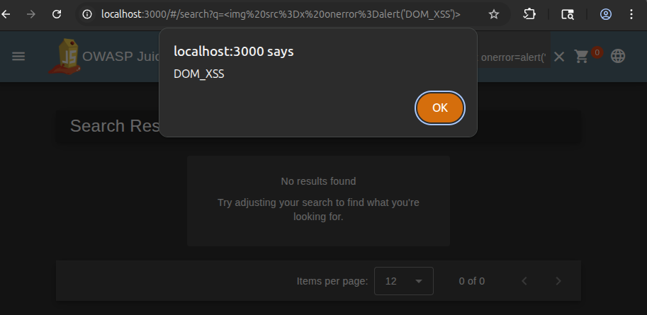
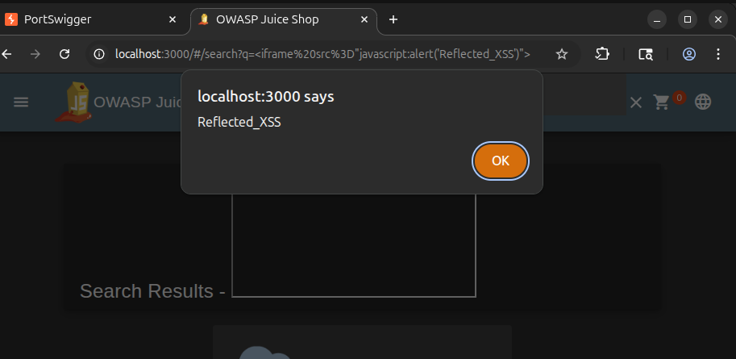
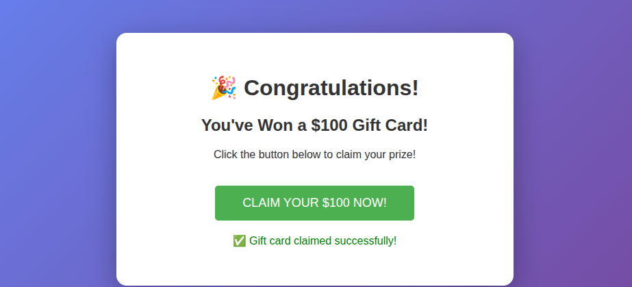
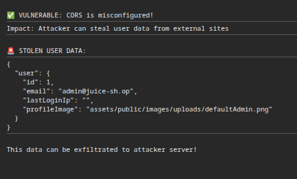

# Client-Side Assessment

Target: OWASP Juice Shop (local Docker instance). Six client-side findings, each with a working proof-of-concept and mitigations.

## Findings

**1. DOM-based XSS (search bar)**
The search field inserts the query directly into the DOM without sanitization. Payload: `` executes on render.
*Fix:* use `textContent` instead of `innerHTML`, sanitize with a library such as DOMPurify, avoid dangerous DOM sinks (`innerHTML`, `document.write`, `eval`), and enforce a strict CSP.

**2. Reflected XSS (search query parameter)**
The search term is reflected unescaped from the URL back into the page. Payload delivered via an `<iframe src="javascript:...">` in the query string triggers execution.
*Fix:* validate/HTML-encode all reflected input, use an auto-escaping templating engine, and set a strict CSP blocking inline scripts.

**3. Stored XSS (complaint/feedback form)**
A malicious `<iframe>` payload submitted through the complaint form is stored server-side and returned unsanitized in the API response — confirmed by inspecting the JSON response in Burp Suite.
*Fix:* sanitize on both input and output (not storage alone), apply a strict CSP, and avoid inline JS handlers.

**4. CSRF (password and username change)**
The password/username-change endpoints accept state-changing requests with no anti-CSRF token. Demonstrated by building a standalone HTML page that silently submits a password change when visited by an authenticated user.
*Fix:* anti-CSRF tokens on state-changing requests, `SameSite=Lax/Strict` cookies, and Origin/Referer validation.

**5. Clickjacking (combined with XSS)**
`X-Frame-Options` blocks framing from other origins but not same-origin framing — which, combined with the DOM XSS above, allows a crafted same-origin URL to render an invisible overlay ("you won a prize") above the real UI and hijack clicks.
*Fix:* `Content-Security-Policy: frame-ancestors 'none'`, correct use of `X-Frame-Options: DENY`.

**6. CORS misconfiguration**
API responses (e.g. `/rest/user/whoami`) return `Access-Control-Allow-Origin: *`, verified by issuing a cross-origin `fetch()` with credentials from the browser console and successfully reading back authenticated user data.
*Fix:* whitelist specific trusted origins, never combine `*` with credentialed requests, validate `Origin` server-side.

See `report-original.pdf` for full reproduction steps, Burp Suite evidence and screenshots for each finding.
