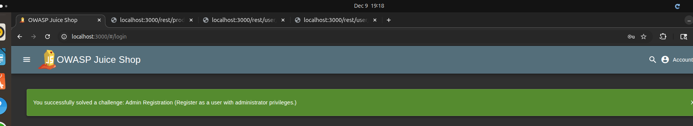

# Server-Side Assessment

Target: OWASP Juice Shop (local Docker instance). Six server-side findings spanning injection, broken access control, and authentication flaws.

## Findings

**1. SQL injection — authentication bypass**
The login form concatenates user input into a SQL query. Payload `' OR 1=1--` in the email field bypasses authentication entirely and logs in as the first user in the database (an admin account), verified both via Burp Suite and directly in the UI.
*Fix:* parameterized queries/prepared statements, server-side input validation, least-privilege DB accounts, generic error messages.

**2. SQL injection — search endpoint (filter bypass)**
`GET /rest/products/search?q='))--` comments out the `deletedAt IS NULL` clause of the underlying query, returning soft-deleted products that should not be visible.
*Fix:* same as above — never build queries via string concatenation; use an ORM's parameterized query methods.

**3. Broken access control — IDOR on shopping basket**
`GET /rest/basket/{id}` does not verify that the requested basket belongs to the authenticated user; incrementing the ID in Burp Repeater returns other users' basket contents.
*Fix:* server-side ownership checks (`object.userId !== loggedInUser.id` → 403), indirect/UUID references instead of sequential IDs, centralized authorization middleware.

**4. Broken access control — privilege escalation via registration**
The `POST /api/Users` registration endpoint trusts a client-supplied `role` field. Adding `"role": "admin"` to the registration payload in Burp Suite creates a full administrator account with no special privileges required.
*Fix:* assign roles server-side only, strict schema validation rejecting unexpected fields, authorization checks on any role-changing operation.

**5. Missing rate limiting on login**
`/rest/user/login` has no attempt limit, lockout, or CAPTCHA, allowing unlimited automated login attempts. Demonstrated with Burp Intruder against a small password list, successfully identifying a valid credential by response length/status.
*Fix:* rate limiting, account lockout, CAPTCHA after repeated failures, MFA, monitoring for brute-force patterns.

**6. Authentication bypass — JWT "none algorithm" forgery**
The backend accepts JWTs with `"alg": "none"` without verifying a signature. Decoding a legitimate token, changing `alg` to `none` and `role` to `admin`, and re-encoding it (no signature required) produces a token the server accepts as a valid administrator session.
*Fix:* explicitly reject `alg: none`, enforce signature verification server-side, use short-lived tokens, and cross-check claims against the database rather than trusting the token alone.

See `report-original.pdf` for full reproduction steps, Burp Suite evidence and screenshots for each finding.
